<div align="center">

# archdiagram

**Architecture diagrams as code, that look hand-drawn by someone who cares.**

A small YAML spec in, a crisp inline SVG out — with the official AWS, Google Cloud, Azure,
Kubernetes and brand icons, light and dark themes, and a collision checker that tells your
coding agent exactly how to fix the layout.

[](https://github.com/pingedbrain/archdiagram/actions/workflows/ci.yml)
[](LICENSE)


<picture>
  <source media="(prefers-color-scheme: dark)" srcset="docs/img/mixed-dark.svg">
  
</picture>

<sub>↑ That whole figure is <a href="examples/mixed.yaml">30 lines of YAML</a>, comments included.</sub>

</div>

---

## Why

Most diagram-as-code tools make you choose: **pretty** (drag boxes by hand in a GUI) or
**reproducible** (auto-layout that puts arrows wherever it likes). archdiagram takes a third
path: *you* decide where things go on a grid, *it* handles icons, routing, labels and theming —
and refuses to render until nothing overlaps.

- **Official icons, mixed freely.** AWS, GCP, Azure, Kubernetes and ~3,400 brand marks from
  Simple Icons, normalised to one size so a Lambda next to a Jira logo reads as the same kind of
  thing.
- **Themes for free.** Every colour is a CSS custom property. The same SVG follows the page into
  dark mode — or you force it with `data-theme`.
- **Built for agents.** `check --json` reports every problem with a *verified* fix (each
  suggestion is tried on a copy before it is offered). Claude Code, Codex & co. converge in a
  couple of iterations instead of guessing pixels.
- **No runtime.** Output is plain SVG: paste it into HTML, a README, an artifact, a slide.
  One dependency (`pyyaml`).

## Quickstart

```bash
uv tool install git+https://github.com/pingedbrain/archdiagram
archdiagram icons fetch            # official packages -> ~/.cache/archdiagram (once)
```

Write a spec:

```yaml
title: Multi-cloud
icons: { packs: [gcp, azure, k8s, brand] }
nodes:
  run:    { icon: gcp:cloud-run,   at: [0, 0], label: Cloud Run }
  bq:     { icon: gcp:bigquery,    at: [1, 0], label: BigQuery }
  fn:     { icon: azure:functions, at: [2, 0], label: Functions }
  cosmos: { icon: azure:cosmos,    at: [3, 0], label: Cosmos DB }
  dep:    { icon: k8s:deployment,  at: [4, 0], label: Deployment }
  gh:     { icon: brand:github,    at: [5, 0], label: GitHub }
edges:
  - { from: run, to: bq, label: loads }
  - { from: bq, to: fn, label: triggers }
  - { from: fn, to: cosmos, label: writes }
  - { from: cosmos, to: dep, label: feeds }
  - { from: dep, to: gh, label: pulls }
```

Check it, then render it:

```bash
archdiagram check multi-cloud.yaml          # validate + lay out + collision-check
archdiagram render multi-cloud.yaml -o out.svg
```

<picture>
  <source media="(prefers-color-scheme: dark)" srcset="docs/img/multi-cloud-dark.svg">
  
</picture>

## The agent loop

The checker is the interface. A broken spec:

```yaml
nodes:
  a: { icon: lamda, at: [0, 0], label: a rather long service name }
  b: { icon: ddb,   at: [1, 0], label: another long service name }
```

```console
$ archdiagram check bad.yaml --json
```

```json
{
  "ok": false,
  "problems": [
    { "kind": "unknown_icon", "element": "node a icon",
      "message": "node a: icon 'lamda' not found in packs aws, generic",
      "suggestion": "closest: aws:lambda, aws:iam" },
    { "kind": "overlap", "element": "node a label", "with": "node b label",
      "box": [132, 97, 182, 114],
      "suggestion": "set label_side: left on node a; or set label_side: right on node b" }
  ]
}
```

Apply the suggestion, run `check` again, repeat until `"ok": true`. That's the whole protocol —
it's spelled out for agents in [`AGENTS.md`](AGENTS.md), and a drop-in skill lives in
[`skills/archdiagram/`](skills/archdiagram/SKILL.md).

## Commands

| Command | What it does |
|---|---|
| `archdiagram check <spec...> [--json]` | Validate, lay out, collision-check. Exit `0` ok · `1` problems · `2` bad input. |
| `archdiagram render <spec> -o out.svg` | Standalone, self-themed SVG. |
| `archdiagram render <spec> -o out.html` | Preview page. |
| `archdiagram render <spec> --fragment` | Just the `<figure>`, to paste into an existing page. |
| `archdiagram css` | The stylesheet for fragments — paste once per page. |
| `archdiagram icons packs` | Packs, versions, licences, cache state. |
| `archdiagram icons fetch [pack...]` | Download official packages into the cache. |
| `archdiagram icons list [--pack aws] [--grep kinesis]` | Every valid `pack:name`. |

`render` refuses while `check` has problems; `--force` overrides overlaps, never broken
references. The full spec — nodes, edges, `via` routing, bands, accents, label placement — is in
[`docs/spec.md`](docs/spec.md).

## Icon packs

| Pack | Source | Licence |
|---|---|---|
| `aws` | AWS Architecture Icons 07312026 (+ group badges) | AWS terms (use in diagrams) |
| `awsres` | AWS Resource Icons 07312026 | AWS terms |
| `generic` | AWS `Res_General-Icons`, recoloured to `currentColor` | AWS terms |
| `gcp` | Google Cloud core product icons | Google terms |
| `azure` | Azure Public Service Icons V24 | Microsoft terms |
| `k8s` | kubernetes/community icons, pinned commit | CC BY 4.0 |
| `brand` | Simple Icons 16.34.0 | CC0 (marks remain trademarks) |

Icons are **never committed** to this repo: providers allow using them in diagrams, not
redistributing the packages, so `icons fetch` downloads them from the source into your cache.
Brand marks belong to their owners; follow their guidelines and don't imply endorsement.
Simple Icons no longer ships the Slack and OpenAI marks (removed at the owners' request) — use
`generic:chat` instead.

Missing an icon? Adding an alias is one line in `src/archdiagram/packs/<pack>.toml`; adding a
whole pack is a manifest. See [`AGENTS.md`](AGENTS.md#icons).

<details>
<summary><b>Offline cache</b></summary>

`ARCHDIAGRAM_CACHE` (default `~/.cache/archdiagram`) holds one directory per pack,
`<pack>-<version>/`, containing the archive's paths plus a `.complete` marker. Without network,
populate it from an already-extracted package, e.g. for AWS:

```bash
C=${ARCHDIAGRAM_CACHE:-~/.cache/archdiagram}/aws-07312026
mkdir -p "$C" && cp -r /path/to/extracted/Architecture-Service-Icons_07312026 "$C"/ && touch "$C/.complete"
```

(`generic-07312026` takes `Resource-Icons_07312026/` the same way.) Or drop the downloaded
archive into `$ARCHDIAGRAM_CACHE/downloads/` under its original file name and run
`archdiagram icons fetch`: it extracts from there without downloading.

</details>

## How it compares

| | archdiagram | [diagrams](https://github.com/mingrammer/diagrams) | [awsdac](https://github.com/awslabs/diagram-as-code) | [Mermaid](https://mermaid.js.org/syntax/architecture.html) `architecture-beta` |
|---|---|---|---|---|
| Input | YAML | Python | YAML | Mermaid DSL |
| Output | themeable SVG | PNG/SVG via Graphviz | PNG | SVG (in Mermaid hosts) |
| Layout | your grid + routing hints | automatic | automatic groups | automatic |
| Providers | AWS · GCP · Azure · k8s · brands | many | AWS | via icon packs |
| Light/dark from one file | ✅ | — | — | host theme |
| Collision check with fixes | ✅ | — | — | — |

Pick `diagrams` when you want automatic layout of big systems; pick archdiagram when the figure
goes in front of people and every arrow should be where you meant it.

## Development

```bash
uv sync
uv run pytest            # no network: tests build fake icon packages in memory
uv run archdiagram check examples/*.yaml
```

README images are rendered from [`examples/`](examples) with `archdiagram render` and a
`data-theme` attribute per variant. `main` is protected: changes land through a PR with green CI.

## License

Code: [MIT](LICENSE). Icons are not part of this repository; each pack keeps its provider's
terms (see `archdiagram icons packs`).
